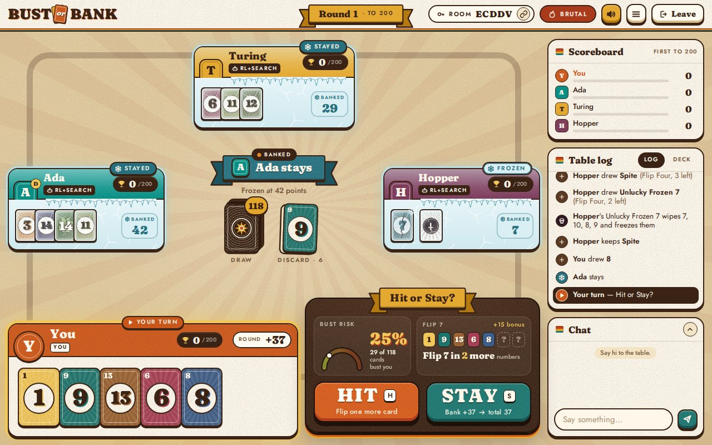
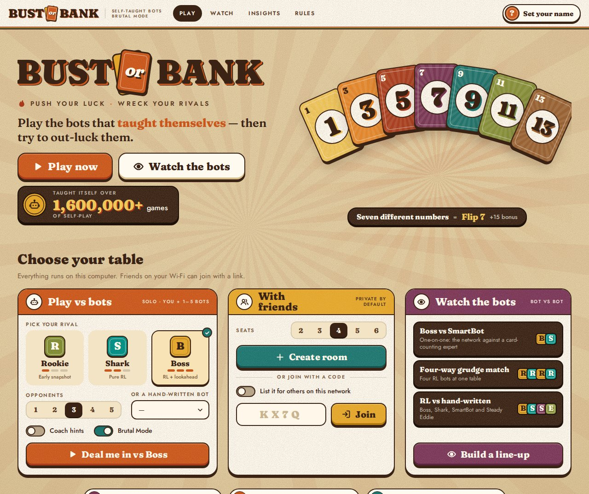
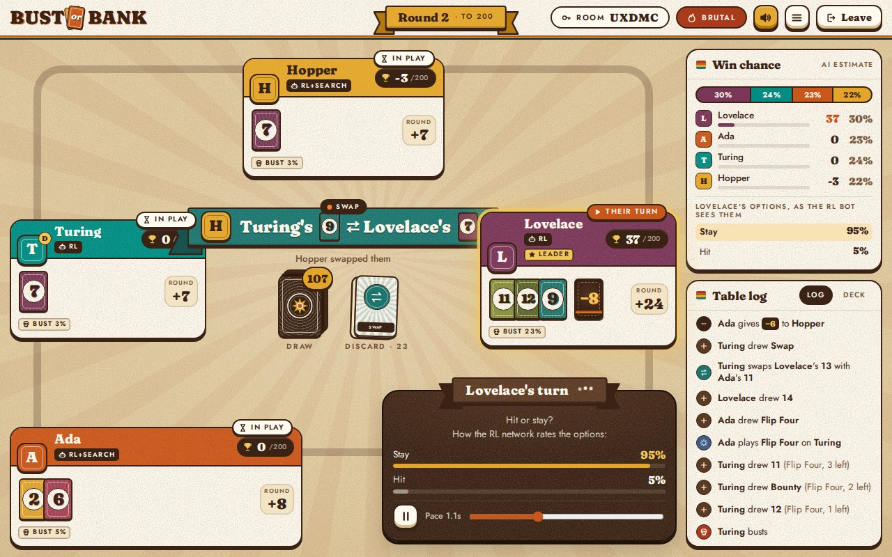
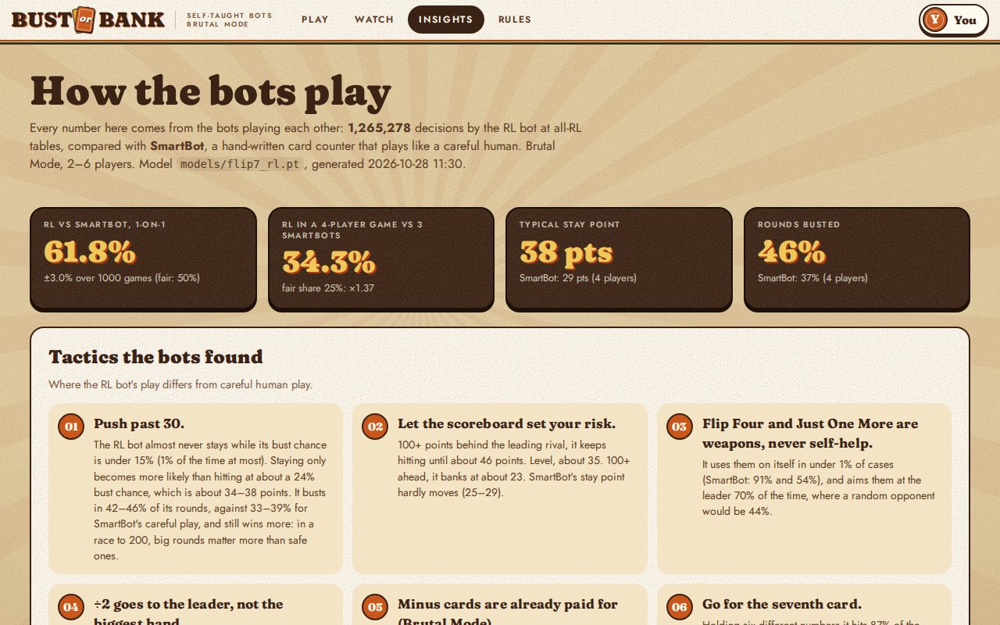

# Bust or Bank RL

**Bust or Bank** is a push-your-luck card game for 2–6 players with a lot of ways to wreck your rivals. This
repository has bots that taught themselves to play it, and a web app to play against them, watch them play
each other, or play with friends.

**[Play in your browser →](https://thverg.github.io/Bust-or-Bank-RL/)** Nothing to install: the bots run
on your own device.



> Bust or Bank is an unofficial fan variant of Flip 7: With a Vengeance, not affiliated with or endorsed by
> its publisher, The Op Games. If you enjoy it, get the real cards.

## The game

On your turn, hit (take a card) or stay (bank your round). Draw a number you already hold and you bust: the
round is lost, and the minus cards you were given still count against you. Collect seven different numbers
and you Flip 7: the round ends at once and you take a 15-point bonus, or take 15 from a rival. First past
200 wins.

The deck has 138 cards: the numbers 0 to 14 (one 0, one 1, two 2s, … fourteen 14s), six modifiers (−2 to −10 and ÷2) that
you hand to a rival, and these:

| Card | What it does |
|---|---|
| The Zero | Worth nothing unless you Flip 7, and while you hold it you must hit. |
| Unlucky Frozen 7 | Wipes every other card in your line and freezes you for the round. |
| Lucky 14 | Hold it and you may have two 14s. |
| Just One More ×2 | Pick a player: they take one card, then must stay. |
| Flip Four ×2 | Pick a player: they take four cards in a row. |
| Swap ×4 | Exchange two cards between two players' lines. A duplicate busts. |
| Steal ×2 | Take a card from a rival's line. |
| Discard ×2 | Throw away any card on the table. |
| Special Delivery ×2 | Flip the next card and choose who gets it. A duplicate busts them. |
| Bounty ×2 | Put it on a rival: whoever busts them this round with their card banks +10. |
| Double Dare ×2 | A rival must hit on their next two turns. |
| Shakedown ×2 | A rival pays you 10 points, or takes a card instead. |
| Robin Hood ×2 | 10 points go from the richest player to the poorest. |
| Tax Collector ×2 | Keep it: when the round is scored, everyone ahead of you pays you 5. |
| Spite ×2 | Keep it: if you bust, pick someone who loses 10 this round. |

[RULES.md](RULES.md) has every rule and edge case.

## What's inside

- **Bots at three levels**, all from one self-play network:

  | Level | What it is |
  |---|---|
  | Rookie | An early snapshot of the network, before it learned the finer points |
  | Shark | The trained network on its own: one forward pass per move |
  | Boss | The network plus search: a one-move lookahead over every possible next card, and each Swap played out to the end of the round 32 times |

  Plus three hand-written bots: SmartBot (a card counter that plays like a careful human), Steady Eddie
  (hits to 25) and Chaos Monkey (random).
- **The web app**: play 1–5 bots, watch any line-up with live win chances and the network's move
  probabilities, host a table for friends, and turn on the coach, which shows each option's win chance
  during the game and reviews your biggest mistakes after it.
- **Insights**: what the bots learned, measured over more than a million of their decisions: when they
  stay, where they aim their weapons, what they do with each new card.
- **The research code**: rules engine, PPO self-play training, search, paired benchmarks, move-by-move
  probes, distillation and the analysis behind the Insights page.

| | |
|---|---|
|  |  |
|  | |

## Play

**[thverg.github.io/Bust-or-Bank-RL](https://thverg.github.io/Bust-or-Bank-RL/)** has everything
except tables with friends: playing the bots, watching them, Insights and the rules. It runs the real
Python engine and bots in your browser with [Pyodide](https://pyodide.org). The first visit downloads
about 13 MB; after that the browser keeps it and a table opens in a few seconds. A game lives in its
browser tab, so reloading the page ends it. [web/README.md](web/README.md) explains how the static build works.

To play with friends, run the server yourself (below). Keyboard: `H` or `Space` to hit, `S` to stay.

## Run it yourself

With Docker:

```bash
docker build -t bust-or-bank .
docker run -p 8077:8077 bust-or-bank
```

Or with Python 3.11+ ([uv](https://docs.astral.sh/uv/) shown; plain `pip` works the same):

```bash
uv venv .venv --python 3.12
uv pip install --python .venv/bin/python torch --index-url https://download.pytorch.org/whl/cpu
uv pip install --python .venv/bin/python numpy fastapi "uvicorn[standard]" pytest

.venv/bin/uvicorn server.app:app --host 0.0.0.0 --port 8077
```

Open <http://localhost:8077>, create a table under *With friends* and share the link.

- **Same Wi-Fi**: friends open `http://<your-computer's-LAN-IP>:8077`; the lobby shows the link.
- **Over the internet**, pick one:
  - [Tailscale](https://tailscale.com): everyone joins your tailnet and uses your Tailscale IP.
  - A Cloudflare quick tunnel: `cloudflared tunnel --url http://localhost:8077` prints a public
    `https://….trycloudflare.com` link. WebSockets work through it.
  - Run the Docker image on any server.

The host can fill empty seats with bots, and if someone drops out a bot can play for them until they
are back. Rooms are saved to `runs/rooms.pkl` (change it with `ROOMS_FILE`), so restarting the
server doesn't lose games.

## How the bots learn

- **What the network sees**: the whole public table from the deciding player's seat: every line,
  status and score, the exact contents of the draw and discard piles (perfect card counting), each
  player's chance to bust or Flip 7, Bounties, Dares and Spites, and the pending Flip Four draws, queued
  actions and Just One More stays. During a Special Delivery it also sees what the revealed card would do
  to each player: bust them, complete their Flip 7, or how many points it adds. One network plays every
  table size from 2 to 6.
- **What it can do**: one flat, masked action space: hit or stay, "target player p", or "card c in
  p's line". That covers every card: who gets a Special Delivery, a Bounty, a Dare or a Shakedown, the
  two steps of a Swap, what to Steal or Discard, paying a Shakedown (stay) or drawing instead (hit), Spite
  and the Flip 7 choice.
- **What it wants**: 1 for winning the game, 0 otherwise. It plays to win the race to 200, not to
  score the most points in a round.
- **How it trains**: PPO with self-play. Workers play many games at once against the current network,
  past snapshots and the hand-written bots. Value targets are bootstrapped at round boundaries, so each
  decision is judged mostly by the luck of its own round instead of the whole game. The network is a
  multilayer perceptron with separate policy and value trunks (about a million parameters). It started
  from a network trained on the original Flip 7: With a Vengeance rules, carried over input by input
  (`flip7/remap.py`), and then played 1.6 million games of Bust or Bank on a desktop CPU.
- **How it was polished**: self-play left it weak at Special Delivery, a decision that comes up two or
  three times a game. After the Delivery inputs above were added, it was fine-tuned to copy the Boss's search on
  Delivery and Shakedown targets, and held close to its own play everywhere else (`flip7/distill.py`).
- **How it searches** (`flip7/search.py`): the Boss scores each move by the network's win chance after
  every possible next card, weighted by how many of each are left. For Swaps it plays every option out
  to the end of the round on 32 shared shuffles. In endgame hit-or-stay decisions it plays the network's
  own move.

## Results at a glance

Win rates of one bot against copies of another, seats rotated, race to 200 (fair share: 50% heads-up, 25%
at 4 players, 17% at 6):

| Table | Shark vs SmartBot | Boss vs SmartBot | Boss vs Shark |
|---|---|---|---|
| 2 players | 61.8% | 64.5% | 52.8% |
| 4 players | 34.2% | 38.9% | 30.5% |
| 6 players | 27.0% | 29.8% | |

1000 games per row (± 3 points), 400 with the Boss (± 5).

- **Training made it better at the bigger tables.** Against the network it started from, 12 hours of
  Bust or Bank self-play gained 2–4 points of win share at 6 players and came out level at 2 and 4.
- **Most of what it learned is about the new cards.** It used to pay a Shakedown half the time at a
  20–30% bust risk; now it pays under 1% of the time and takes the card. It delivers a bust 74% of the time
  when the card allows one, and keeps more than half of the safe numbers for itself.
- **Where it still goes wrong: Steal and Discard.** Scored move by move on fresh positions, the Shark gives
  up about 2 points of win chance per Steal and 0.9 per Discard. The Boss's search cuts both to under 0.5.
  Hit-or-stay, the bulk of the game, costs it 0.03 points per decision.
- **How it plays**: it stays at about 34–38 points and busts in 42–46% of its rounds, against 33–39% for
  SmartBot's careful play, and still wins more: in a race to 200, big rounds matter more than safe ones.
  It aims Flip Four and Just One More at the leader 70% of the time.

[docs/RESULTS.md](docs/RESULTS.md) has the full results: every benchmark, the move-by-move probes,
calibration and how the levels hold up under other rules.

## Repository

| Path | What's there |
|---|---|
| `flip7/` | Rules engine, observation encoding, hand-written bots, PPO training, search, benchmarks and analysis |
| `server/` | FastAPI + WebSocket game server and the web client (plain JavaScript, no build step) |
| `web/` | The static build for GitHub Pages: the same rooms and bots running in the browser |
| `models/` | The networks the app serves (`flip7_rl.pt` is the strongest) |
| `analysis/` | The data behind the Insights page |
| `RULES.md` | The full Bust or Bank rules, including every edge case |
| `docs/` | [Results](docs/RESULTS.md), [training and analysis commands](docs/TRAINING.md) |

## Development

```bash
.venv/bin/python -m pytest -q        # engine, training plumbing, search, server, static build
.venv/bin/python -m web.build        # the GitHub Pages site, into _site/
```

The tests cover the rules engine (a scenario for every card plus card-conservation checks over random
games), the training plumbing, search, the analysis, promotion and the server (full games over real
WebSockets, two humans in one room, rooms surviving a restart), plus the static build (numpy inference
matching torch, rooms running without torch). Every push to `main` runs them and redeploys the site.

[docs/TRAINING.md](docs/TRAINING.md) has the commands to train a network, benchmark it, put it on the
site and regenerate the Insights data.

## License

[MIT](LICENSE). The fonts in `server/static/fonts` are under the SIL Open Font License
([LICENSE.txt](server/static/fonts/LICENSE.txt)).
